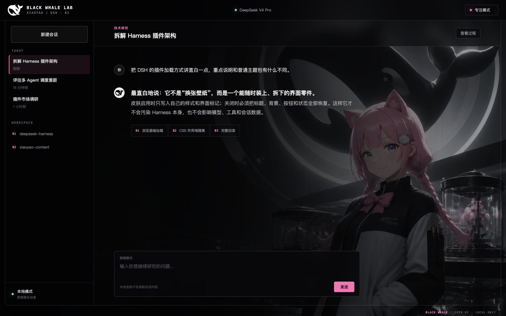
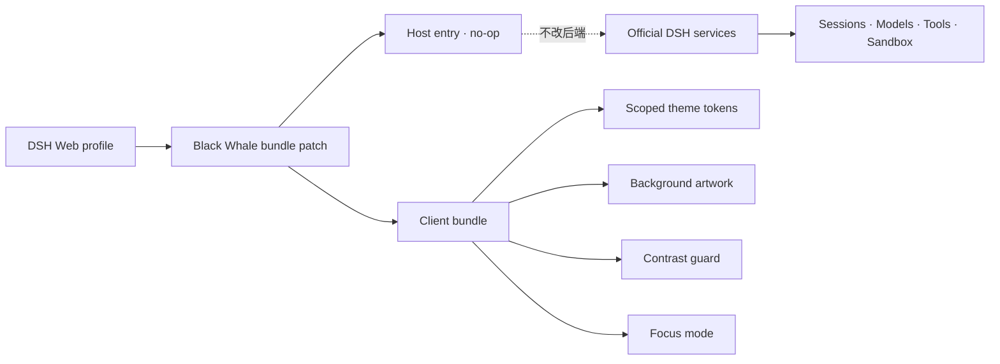

<p align="center">
  
</p>

<h1 align="center">Black Whale Lab · 黑鲸实验室</h1>

<p align="center">
  夕小瑶 × DeepSeek Harness：让真实 DSH Web 主画布透出黑鲸与小瑶的专业实验室皮肤。
</p>

<p align="center">
  <a href="README.en.md">English</a> ·
  <a href="#安装">安装</a> ·
  <a href="#它如何工作">原理</a> ·
  <a href="https://github.com/147228/dsh-black-whale/issues">反馈问题</a>
</p>

<p align="center">
  <a href="https://github.com/147228/dsh-black-whale/actions/workflows/ci.yml"></a>
  <a href="https://github.com/147228/dsh-black-whale/releases"></a>
  <a href="LICENSE"></a>
  <a href="ASSET_LICENSE.md"></a>
  <a href="https://github.com/topics/dsh-plugin"></a>
</p>

## 它不是一张盖在界面上的壁纸

Black Whale Lab 是一个真实的 DeepSeek Harness Web 客户端插件。它通过 DSH 的 profile 与 Cordis 插件加载器进入官方 Web 应用，保留原生会话、模型、工具、沙箱、权限和设置能力，只接管浏览器表现层。

- **背景透传**：处理 DSH 嵌套的两层基础画布，让鲸鱼与小瑶真正进入主工作区。
- **局部承载**：侧栏、输入卡、菜单和弹窗仍保持可靠底色，文字不会落进复杂背景。
- **自动对比度保护**：运行时识别“浅底＋浅字”控件并自动切换深色文字，不依赖易变化的 CSS 哈希类名。
- **专注模式**：右上角一键压暗画布，适合长对话、代码和日志阅读。
- **完整回滚**：卸载时恢复标题、背景、DOM 与样式作用域，不污染 Harness 本身。
- **本地优先**：不读取会话，不发送提示词，不调用模型，不上传任何数据。

## 安装

要求：可正常运行的 DeepSeek Harness Web profile。当前版本在 DSH `0.1.0-rc.6`、Node.js 24 上完成真实验收。

### 从 GitHub Release 安装（推荐）

```sh
dsh plugin --profile web add \
  https://github.com/147228/dsh-black-whale/releases/download/v0.1.3/xiaoyao-ai-dsh-client-ui-skin-black-whale-0.1.3.tgz
```

也可以直接安装固定 Git tag：

```sh
dsh plugin --profile web add github:147228/dsh-black-whale#v0.1.3
```

安装后重启：

```sh
dsh web
```

> 全局皮肤会覆盖同一批主题变量。若已经安装其他 DSH 全局皮肤，请先移除旧皮肤，再安装 Black Whale Lab。

### 验证

```sh
dsh web --dump-config | grep -n "ui-skin-black-whale"
```

输出中出现 `ui-skin-black-whale`，并且在「设置 → 插件 → 插件列表」中显示“已挂载”，即表示 DSH 已加载本插件。

### 升级与卸载

```sh
# 升级到指定版本
dsh plugin --profile web add github:147228/dsh-black-whale#v0.1.3

# 卸载
dsh plugin --profile web remove @xiaoyao-ai/dsh-client-ui-skin-black-whale
```

随后重启 `dsh web`。完整故障排查见 [INSTALL.md](INSTALL.md)。

## 它如何工作



插件包通过 `cordis.patch.yml` 插入 `ui-skin-black-whale`。Host 入口为空实现；浏览器入口使用 `body[data-dsh-black-whale]` 隔离所有样式，并将图片编译成 data URI。因此安装后不依赖本地绝对路径，也不会替换或模拟官方后端。

## 兼容性

| 项目 | 状态 |
| --- | --- |
| DeepSeek Harness `0.1.0-rc.6` | 真实 Web profile 已验收 |
| macOS / Windows / Linux | 构建依赖不绑定特定平台，CI 覆盖三平台 |
| Chromium 系浏览器 | 支持 |
| 不支持 `backdrop-filter` 的浏览器 | 自动使用不透明面板兜底 |
| 其他全局 DSH 皮肤同时启用 | 不推荐，主题变量会竞争 |

真实验收覆盖 Host transport、持久化会话、工作区、模型、设置、插件清单、对比度保护与专注模式；验收过程不发送模型请求。

## 本地开发

```sh
git clone https://github.com/147228/dsh-black-whale.git
cd dsh-black-whale
pnpm install --frozen-lockfile
pnpm check
pnpm dev -- --host 127.0.0.1 --port 4173
```

静态交互预览位于 `http://127.0.0.1:4173/preview/`。开发版链接到本机 profile：

```sh
dsh plugin --profile web add link:$(pwd)
```

## 隐私与安全

本插件是纯表现层，没有网络请求、凭据访问、会话读取或模型调用。安全问题请按 [SECURITY.md](SECURITY.md) 私下报告；普通兼容性问题请提交 [Issue](https://github.com/147228/dsh-black-whale/issues/new/choose)。

## 许可证与品牌

- 源代码： [MIT](LICENSE)
- 小瑶实验室主视觉： [CC BY-NC 4.0](ASSET_LICENSE.md)
- DeepSeek Harness 与黑鲸标识：上游 MIT 代码资产，同时可能受商标规则约束

本项目是社区插件，与 DeepSeek 无隶属、赞助或官方背书关系。详见 [THIRD_PARTY_NOTICES.md](THIRD_PARTY_NOTICES.md)。

## 致谢

- [DeepSeek Harness](https://github.com/deepseek-ai/deepseek-harness) — Everything is a Plugin.
- 夕小瑶科技说社区提供的小瑶 IP 与视觉方向。
